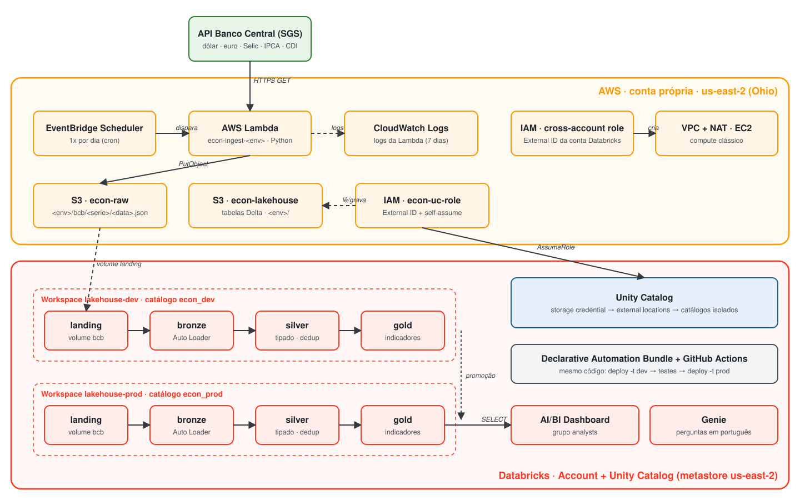
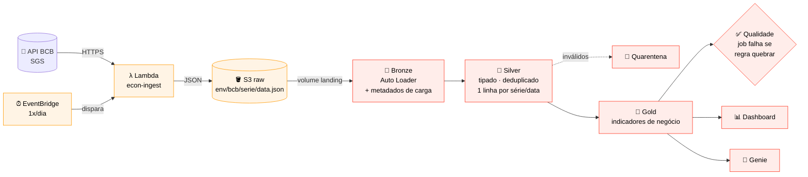
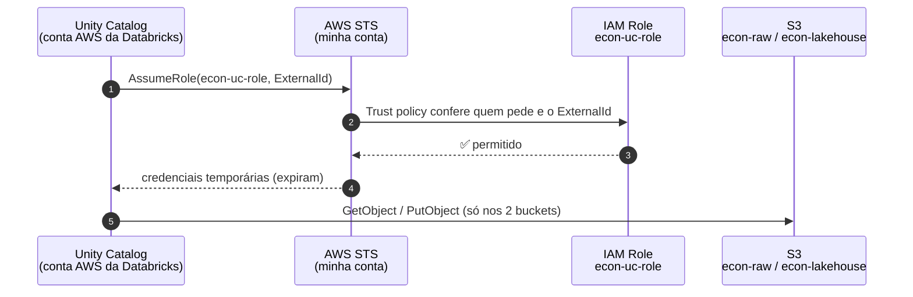
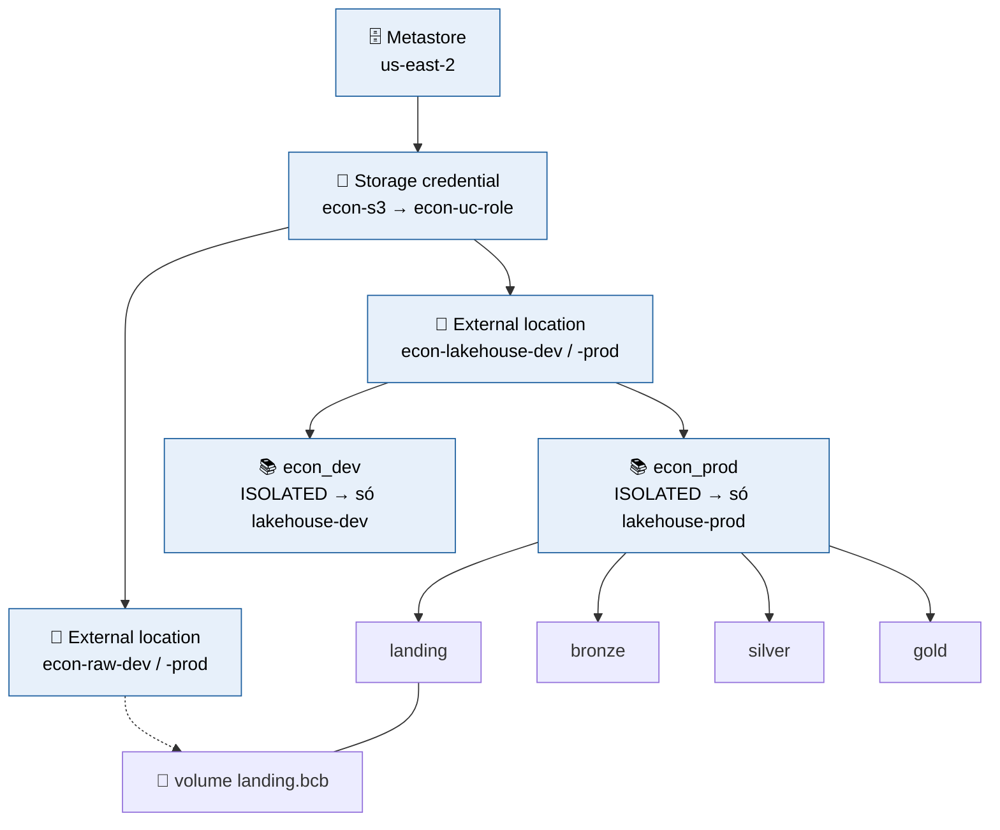
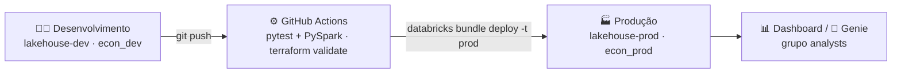

<div align="center">

# 🏦 Lakehouse de Indicadores Econômicos · AWS + Databricks

**Plataforma de dados de ponta a ponta, em ambientes DEV e PROD isolados, construída 100% com infraestrutura como código.**
Dados reais do **Banco Central do Brasil** são coletados por uma **AWS Lambda**, armazenados no **S3**, governados pelo **Unity Catalog** e refinados na arquitetura **medalhão** (Bronze → Silver → Gold) até chegar ao negócio em **Dashboard** e **Genie**.


</div>

---

## 📌 Sumário

- [Visão geral](#-visão-geral)
- [Arquitetura](#-arquitetura)
- [Segurança: como a Databricks acessa a AWS](#-segurança-como-a-databricks-acessa-a-aws)
- [Governança com Unity Catalog](#-governança-com-unity-catalog)
- [Ambientes e promoção DEV → PROD](#-ambientes-e-promoção-dev--prod)
- [Dados: API do Banco Central](#-dados-api-do-banco-central)
- [Estrutura do repositório](#-estrutura-do-repositório)
- [Como reproduzir](#-como-reproduzir)
- [Custos](#-custos)
- [Status do projeto](#-status-do-projeto)
- [Aprendizados](#-aprendizados)

---

## 🎯 Visão geral

| Pergunta | Resposta |
|---|---|
| **Qual problema?** | Centralizar indicadores econômicos (câmbio, juros, inflação) numa plataforma governada, com histórico e acesso controlado por perfil. |
| **De onde vem o dado?** | API pública SGS do Banco Central do Brasil. |
| **Onde roda?** | Na **minha conta AWS** (us-east-2): workspaces Databricks clássicos, com compute na minha VPC e dados no meu S3. |
| **Como é criado?** | Três stacks **Terraform**: workspaces, governança e ingestão. Nada foi clicado à mão. |
| **Quem consome?** | Analistas, que veem **só a camada Gold, só em PROD**. |

### Stack

| Camada | Tecnologias |
|---|---|
| Ingestão | AWS Lambda (Python) · Amazon EventBridge Scheduler · CloudWatch Logs |
| Armazenamento | Amazon S3 (raw + lakehouse) · Delta Lake |
| Segurança | AWS IAM (cross-account role, External ID, self-assuming role) · bucket policies · criptografia SSE-S3 |
| Rede | VPC gerenciada pela Databricks, com NAT Gateway, na conta AWS |
| Governança | Unity Catalog: storage credential, external locations, catálogos isolados por workspace, grupos e grants |
| Processamento | Lakeflow Jobs (serverless) · PySpark · Auto Loader (`availableNow`) · Spark SQL |
| CI/CD | Declarative Automation Bundles (DABs) · GitHub Actions |
| Consumo | AI/BI Dashboard · Genie (com `embed_credentials: false`: cada pessoa vê só o que o Unity Catalog permite) |
| IaC | Terraform (providers `aws`, `databricks`, `time`) |

---

## 🏗 Arquitetura



> Fonte editável do diagrama: [`docs/img/arquitetura.excalidraw`](docs/img/arquitetura.excalidraw) (abra em [excalidraw.com](https://excalidraw.com)).

### Fluxo do dado



| Camada | Schema | Conteúdo | Regra principal |
|---|---|---|---|
| **Landing** | `landing` | Volume `bcb` apontando para `s3://econ-raw-…/<env>/bcb/` | Arquivo exatamente como veio da API |
| **Bronze** | `bronze` | `bcb_series_raw`: JSON em Delta + `_arquivo_origem`, `_carregado_em` (Auto Loader com checkpoint) | Nunca altera o dado, só adiciona metadados |
| **Silver** | `silver` | `bcb_observacoes` (tipado) + `bcb_observacoes_rejeitadas` (quarentena) | Sem duplicatas: 1 linha por `serie` + `data`, fica a coleta mais recente |
| **Gold** | `gold` | `cambio_diario`, `indicadores_mensais`, `ultimos_valores` | Pronto para o negócio; único schema visível aos analistas |

---

## 🔐 Segurança: como a Databricks acessa a AWS

Nenhuma chave de acesso (*access key*) é criada. A Databricks **assume roles IAM** na minha conta, e a AWS só permite quando o pedido vem com o **External ID**, um identificador único da minha conta Databricks. Isso evita o ataque conhecido como *confused deputy*.



| Role IAM | Quem assume | Para quê | Limite |
|---|---|---|---|
| `databricks-lakehouse-cross-account-role` | Control plane da Databricks | Criar EC2, VPC e NAT para os clusters | Só ações de EC2 necessárias |
| `databricks-lakehouse-storage-role` | Unity Catalog | Bucket raiz dos workspaces | Só o prefixo `unity-catalog/` |
| `econ-uc-role` | Unity Catalog (storage credential) | Ler e gravar os dados do projeto | Só os buckets `econ-raw` e `econ-lakehouse` |
| `econ-ingest-<env>` | AWS Lambda | Gravar o JSON da API | Só `PutObject` em `<env>/bcb/*` |

**Outras práticas aplicadas:** buckets com bloqueio total de acesso público e criptografia SSE-S3; MFA no root e no usuário IAM; nenhum segredo no código (o Terraform usa apenas *nomes* de profiles do AWS CLI e do Databricks CLI); `tfstate` e `tfvars` fora do Git.

---

## 🛡 Governança com Unity Catalog



### Quem vê o quê

| Grupo | Workspace DEV | Workspace PROD | Permissões no Unity Catalog |
|---|---|---|---|
| `platform-admins` | ADMIN | ADMIN | Dono dos catálogos, credentials e external locations |
| `data-engineering` | USER | USER | **DEV:** lê e escreve em tudo · **PROD:** só leitura (quem escreve é o job publicado) |
| `analysts` | ❌ sem acesso | USER | Só `USE_CATALOG` em `econ_prod` + `USE_SCHEMA`/`SELECT` no schema **`gold`** |

**Decisões de governança:**
- **Catálogos isolados (`ISOLATED`):** o `econ_prod` não aparece no workspace DEV, então ninguém escreve em produção por engano a partir de um notebook de desenvolvimento.
- **Permissões para grupos, nunca para pessoas:** quem entra ou sai do time só muda de grupo, e os grants continuam os mesmos.
- **Um schema por camada:** o acesso do negócio é dado no schema `gold` inteiro e vale para as tabelas futuras, sem grant tabela por tabela.
- **Tudo em Terraform:** grupos, atribuição aos workspaces, catálogos, schemas, volume e grants estão em [`infra/02-governance`](infra/02-governance).

---

## 🔁 Ambientes e promoção DEV → PROD



| | DEV | PROD |
|---|---|---|
| Workspace | `lakehouse-dev` | `lakehouse-prod` |
| Catálogo | `econ_dev` | `econ_prod` |
| Dados brutos | `s3://econ-raw-…/dev/bcb/` | `s3://econ-raw-…/prod/bcb/` |
| Bundle | `mode: development` (recursos com prefixo do usuário, agendas pausadas) | `mode: production` (só admins publicam) |
| Consumo | — | Dashboard + Genie para `analysts` |

O **mesmo código** vai para os dois ambientes. Só muda a configuração do target do bundle.

---

## 📈 Dados: API do Banco Central

API pública **SGS (Sistema Gerenciador de Séries Temporais)**, sem autenticação: `https://api.bcb.gov.br/dados/serie/bcdata.sgs.{codigo}/dados?formato=json`

| Código SGS | Série | Periodicidade |
|---|---|---|
| `1` | Dólar americano (venda) | diária |
| `21619` | Euro (venda) | diária |
| `432` | Meta da taxa Selic (% a.a.) | por reunião do Copom |
| `12` | CDI (% a.d.) | diária |
| `433` | IPCA: variação mensal (%) | mensal |

---

## 🗂 Estrutura do repositório

```text
.
├── infra/                          # Infraestrutura como código (Terraform)
│   ├── 01-workspaces/              #   bucket raiz, IAM roles, credential, storage config, workspaces DEV/PROD
│   ├── 02-governance/              #   buckets de dados, econ-uc-role, grupos, Unity Catalog, grants
│   │   └── modules/environment/    #     módulo reutilizado por ambiente (catálogo, schemas, volume, grants)
│   └── 03-ingestion/               #   Lambda + EventBridge Scheduler + IAM + CloudWatch
├── ingestion/                      # Código Python da Lambda + testes (pytest)
├── platform/                       # Bundle Databricks (promovido DEV → PROD)
│   ├── databricks.yml              #   targets dev/prod
│   ├── resources/                  #   job econ-daily (4 tarefas serverless)
│   ├── src/econ/transforms.py      #   regras da Silver (PySpark, testadas)
│   ├── src/notebooks/              #   01_bronze · 02_silver · 03_gold · 04_qualidade
│   ├── src/sql/gold/               #   1 SELECT por tabela Gold
│   ├── src/dashboards/ · src/genie/ #   dashboard e Genie (JSON gerado por script, só em PROD)
│   └── tests/                      #   pytest + PySpark local
├── docs/
│   ├── img/                        #   diagrama de arquitetura (SVG + Excalidraw)
│   ├── aprendizado/                #   o que aprendi em cada etapa + perguntas de entrevista
│   └── evidencias/                 #   prints da execução
├── aws-manual/                     # Passo a passo do setup manual no console + modelos de policies
├── .github/workflows/ci.yml        # CI: terraform fmt/validate (+ pytest)
└── Makefile                        # atalhos dos comandos
```

---

## 🚀 Como reproduzir

**Pré-requisitos:** conta AWS, conta Databricks com acesso ao Account Console (o trial serve), AWS CLI v2, Terraform ≥ 1.5, Databricks CLI e [uv](https://docs.astral.sh/uv/).

```bash
# 0. Logins (sem segredos em arquivo: tudo por navegador/OAuth)
aws login --profile <aws-profile> --region us-east-2
databricks auth login --host https://accounts.cloud.databricks.com --account-id <ACCOUNT_ID> --profile workshop-account

# 1. Workspaces DEV e PROD
cd infra/01-workspaces && cp terraform.tfvars.example terraform.tfvars   # preencha
terraform init && terraform plan && terraform apply

# 2. Login em cada workspace (URLs no output do passo 1)
databricks auth login --host <url-dev>  --profile lakehouse-dev
databricks auth login --host <url-prod> --profile lakehouse-prod

# 3. Governança: buckets, role, grupos, catálogos e grants
cd ../02-governance && cp terraform.tfvars.example terraform.tfvars      # preencha
terraform init && terraform plan && terraform apply
```

```bash
# 4. Ingestão: Lambdas + agendamento
cd ../03-ingestion && cp terraform.tfvars.example terraform.tfvars        # preencha
terraform init && terraform apply

# 5. Carga histórica (uma vez por ambiente)
aws lambda invoke --function-name econ-ingest-dev  --cli-binary-format raw-in-base64-out --payload '{"start_date":"2024-01-01"}' /dev/stdout
aws lambda invoke --function-name econ-ingest-prod --cli-binary-format raw-in-base64-out --payload '{"start_date":"2024-01-01"}' /dev/stdout
```

```bash
# 6. Testes locais (estágio TEST)
cd platform && uv run --no-project --with pytest --with "pyspark==4.0.*" pytest tests -q

# 7. DEV → PROD com o mesmo código
databricks bundle deploy -t dev  && databricks bundle run econ_daily -t dev
databricks bundle deploy -t prod && databricks bundle run econ_daily -t prod
```

---

## 💰 Custos

| Item | Custo aproximado |
|---|---|
| Workspace clássico parado (NAT Gateway + IP público) | ~US$ 1,20/dia por workspace |
| EC2 e DBUs | só durante o uso |
| Lambda, EventBridge, S3, IAM | praticamente zero (free tier) |

Controles: **AWS Budget** com alerta em US$ 5 (contando o gasto antes dos créditos) e destruição de tudo com `terraform destroy` ao final (ingestão → governança → workspaces).

---

## ✅ Status do projeto

- [x] Workspaces DEV e PROD na AWS via Terraform
- [x] Governança: buckets, IAM, grupos, catálogos isolados, schemas por camada e grants
- [x] Ingestão: Lambda + EventBridge gravando a API do BCB no S3 (backfill desde 01/2024)
- [x] Pipeline Bronze → Silver → Gold (job serverless + Auto Loader + quarentena + testes PySpark)
- [x] Promoção DEV → PROD com bundles (mesmo código, agenda ativa só em PROD) + CI no GitHub Actions
- [x] Consumo: AI/BI Dashboard e Genie em PROD, com `embed_credentials: false` (governança até o consumo)
- [ ] Evidências e limpeza do ambiente

---

## 📚 Aprendizados

O material de estudo que escrevi em cada etapa está em [`docs/aprendizado/`](docs/aprendizado):

| # | Tema |
|---|---|
| 01 | [Terraform: infraestrutura como código](docs/aprendizado/01-terraform.md) |
| 02 | [IAM e Unity Catalog: a Databricks acessando a AWS com segurança](docs/aprendizado/02-iam-e-unity-catalog.md) |
| 03 | [Ingestão serverless: Lambda + EventBridge + S3](docs/aprendizado/03-ingestao-lambda.md) |
| 04 | [Medalhão: Auto Loader, PySpark, Jobs serverless e Bundles](docs/aprendizado/04-medalhao-jobs-bundles.md) |
| 05 | [Troubleshooting: problemas reais e como foram investigados](docs/aprendizado/05-troubleshooting.md) |
| 06 | [Consumo: Dashboard e Genie com governança](docs/aprendizado/06-consumo-dashboard-genie.md) |

---

<sub>Projeto inspirado no workshop *Do Zero à Produção: Databricks Enterprise na AWS* (Jornada de Dados, [repositório original](https://github.com/lvgalvao/SetupDatabricks)). A infraestrutura de workspaces partiu desse material; o tema, os dados, a ingestão na AWS, o modelo de governança por camadas e o pipeline são deste projeto.</sub>
